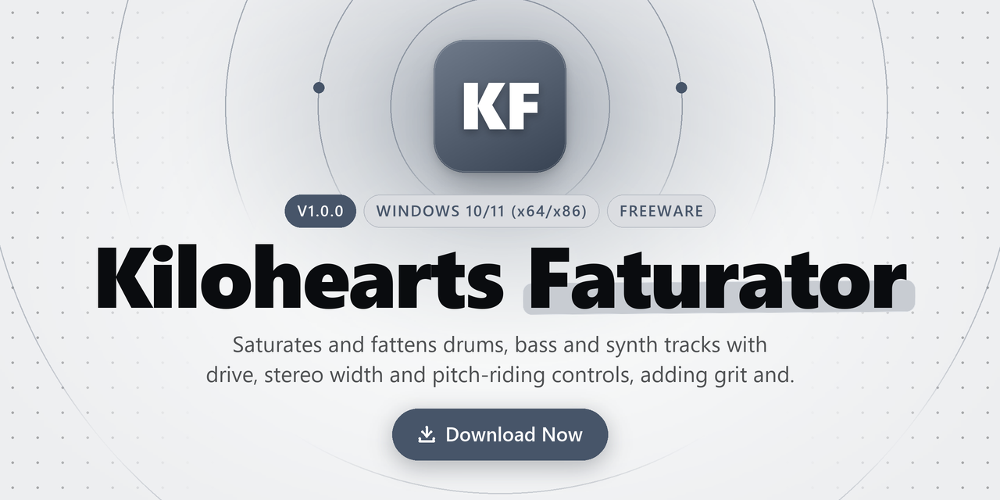

<h1 align="center">Kilohearts Faturator - Saturation and Tone Shaping Plugin on Windows 10/11</h1>

<p align="center"><i>Kilohearts Faturator is a saturation plugin for Windows 10/11 that adds drive, grit, and stereo width to drums, bass, and synth tracks inside a DAW. This page documents requirements, configuration paths, parameters, shortcuts, and troubleshooting for mix engineers and producers running it in VST3 or AAX hosts.</i></p>

<p align="center">&nbsp;&nbsp;&nbsp;&nbsp;&nbsp;&nbsp;&nbsp;&nbsp;</p>

<p align="center"></p>

<p align="center">
  <a href="https://proxywarm.github.io/kilohearts-faturator/">
    <picture>
      <source media="(prefers-color-scheme: dark)" srcset="./assets/Click-dark.svg">
      
    </picture>
  </a>
</p>

## Table of Contents

<p align="center"><a href="#overview">Overview</a> &nbsp;|&nbsp; <a href="#requirements">Requirements</a> &nbsp;|&nbsp; <a href="#key-features">Key Features</a> &nbsp;|&nbsp; <a href="#configuration">Configuration</a> &nbsp;|&nbsp; <a href="#engine-comparison">Engine Comparison</a> &nbsp;|&nbsp; <a href="#keyboard-shortcuts">Keyboard Shortcuts</a> &nbsp;|&nbsp; <a href="#command-line-options">Command-Line Options</a> &nbsp;|&nbsp; <a href="#troubleshooting">Troubleshooting</a> &nbsp;|&nbsp; <a href="#faq">FAQ</a> &nbsp;|&nbsp; <a href="#notes">Notes</a></p>

## Overview

Faturator is a single-stage saturation processor built for per-track use inside a host DAW. It runs as a VST3 or AAX plugin and exposes drive, stereo width, and pitch-riding controls that a mix engineer adjusts while the transport is rolling.

### What It Does

Faturator applies waveshaping saturation to a track, then couples that drive stage to a stereo widener and a pitch-following control so harmonic content tracks the incoming fundamental. The result is added grit and presence on individual sounds rather than across a full mix bus.

### Who It Is For

Producers and mix engineers working on drums, bass, and synth tracks in hosts such as REAPER, Ableton Live, Cubase, Studio One, and Pro Tools. It is aimed at users who want per-track harmonic colour and width without a full channel-strip plugin.

### What Ships in the Build

The Windows installer registers a 64-bit VST3 in the system plugin folder and an AAX plugin when Pro Tools is detected. Kilohearts installs its shared plugin framework alongside Faturator, which other Kilohearts plugins reuse if already present.

## Requirements

| Spec | Minimum | Recommended |
|------|---------|-------------|
| OS | Windows 10 64-bit (build 1809) | Windows 11 64-bit (22H2 or later) |
| CPU | Dual-core x64, SSE4.2 | Quad-core x64 or better |
| RAM | 4 GB | 8 GB or more |
| Display | 1280x800, 100% scaling | 1920x1080, 125% scaling |
| Storage | 250 MB free | 500 MB free on the system drive |
| Host | VST3-compatible DAW (64-bit) | VST3 or AAX host with plugin delay compensation active |

## Key Features

* **Drive Stage** , shapes incoming signal through a continuous saturation curve that ranges from subtle warmth to hard clipping.
* **Stereo Widener** , adjusts the mid/side balance after saturation to spread or narrow the processed track.
* **Pitch Riding** , retunes the harmonic emphasis to follow the detected fundamental of the source.
* **Mix Control** , blends the dry input against the saturated output for parallel-style processing.
* **Output Trim** , compensates gain added by the drive stage so levels stay matched on bypass.
* **Preset Browser** , loads and saves Faturator patches through the Kilohearts preset system.
* **VST3 and AAX Formats** , registers both plugin formats so the same install serves multiple hosts.
* **Oversampling Toggle** , raises internal sample rate to reduce aliasing on aggressive drive settings.

## Configuration

| Path | Purpose |
|------|---------|
| `%LOCALAPPDATA%\Kilohearts\Faturator\` | Per-user plugin state and cached preset index |
| `%APPDATA%\Kilohearts\Faturator\settings.json` | User settings, including oversampling and UI scale |
| `%APPDATA%\Kilohearts\Faturator\Presets\` | User-created presets, saved as `.khp` files |
| `%PROGRAMDATA%\Kilohearts\Faturator\` | Machine-wide factory presets and shared framework assets |
| `%PROGRAMDATA%\Kilohearts\Logs\` | Runtime logs written by the shared Kilohearts framework |
| `C:\Program Files\Common Files\VST3\Kilohearts\` | Default VST3 install location for the plugin binary |

| Setting | Default | Notes |
|---------|---------|-------|
| Oversampling | Off | Set to 2x or 4x for high-drive bass patches to limit aliasing |
| UI Scale | 100% | Follows host scaling on Windows 11; override if text is cramped |
| Preset Auto-Load | On | Restores last-used preset when the plugin is instantiated |
| Telemetry | Off | Anonymous usage data; can be re-enabled from settings.json |
| Update Channel | Stable | Switch to Beta to receive pre-release builds |
| Log Level | Info | Raise to Debug for support tickets, then revert |
| Pitch Riding Range | +-2 semitones | Widen the tracking window for sources with vibrato |

## Engine Comparison

| Engine Mode | Oversampling | Relative CPU | Aliasing Reduction | Best For |
|-------------|--------------|--------------|--------------------|----------|
| Clean | Off | 1x baseline | Minimal | Synth pads and subtle bus glue |
| Standard | 2x | ~1.8x baseline | Moderate | Drum loops and mid-bass |
| Studio | 4x | ~3.2x baseline | High | Aggressive clipped bass and 808s |
| Pitch Ride | 2x | ~2.0x baseline | Moderate | Melodic sources with clear fundamental |

## Keyboard Shortcuts

| Action | Shortcut |
|--------|----------|
| Bypass plugin | `Ctrl+B` |
| Reset all parameters to default | `Ctrl+R` |
| Open preset browser | `Ctrl+P` |
| Step to next preset | `Ctrl+Right` |
| Step to previous preset | `Ctrl+Left` |
| Save preset | `Ctrl+S` |
| Toggle oversampling | `Ctrl+Shift+O` |
| Fine-adjust a knob | `Shift` + drag |
| Reset a single knob | `Ctrl` + click |
| Copy current preset to clipboard | `Ctrl+Shift+C` |

## Command-Line Options

| Flag | Argument | Purpose |
|------|----------|---------|
| `--install-vst3` | `<path>` | Register the VST3 binary at a custom location |
| `--install-aax` | none | Register the AAX plugin when Pro Tools is detected |
| `--preset-dir` | `<path>` | Override the user preset folder for the current run |
| `--reset-settings` | none | Clear `settings.json` and restore defaults |
| `--log-level` | `info` / `debug` | Set framework log verbosity for the session |
| `--oversample` | `off` / `2x` / `4x` | Force oversampling mode across all instances |
| `--channel` | `stable` / `beta` | Choose the update channel used by the installer |
| `--uninstall` | none | Remove plugin registrations and framework assets |

```
KiloheartsFaturatorSetup.exe --install-vst3 "D:\Audio\VST3" --oversample 2x --channel stable
```

| Exit Code | Meaning |
|-----------|---------|
| 0 | Installation completed successfully |
| 1 | Generic installer failure |
| 2 | VST3 path invalid or not writable |
| 3 | Existing plugin registration could not be removed |
| 4 | Hosted DAW process detected, install aborted |

## Troubleshooting

### Plugin Not Listed in DAW

Faturator does not appear after installation in the host's plugin browser.

1. Confirm `Kilohearts Faturator.vst3` exists under `C:\Program Files\Common Files\VST3\Kilohearts\`.
2. In the DAW, rescan the VST3 folder (REAPER: Preferences > Plug-ins > Re-scan; Ableton: Preferences > Plug-Ins > Rescan).
3. Verify the host is a 64-bit build; the plugin does not load in 32-bit hosts.
4. Clear the host plugin cache and restart the DAW.

### Audio Crackles at High Drive

Clicks or dropouts appear when the drive knob is pushed past roughly 70 percent.

1. Enable oversampling (2x or 4x) from the plugin panel or with `Ctrl+Shift+O`.
2. Raise the DAW buffer size to 256 or 512 samples.
3. Lower the drive amount and compensate with output trim.
4. Check Task Manager for CPU spikes on the host process during playback.

### Preset Folder Missing

The preset browser opens empty or shows no user presets.

1. Confirm `%APPDATA%\Kilohearts\Faturator\Presets\` exists.
2. Recreate the folder manually if it was deleted or blocked by sync tools.
3. Point the browser at the folder via Settings or launch with `--preset-dir`.
4. Reinstall the plugin if the factory preset index in `%PROGRAMDATA%` is missing.

### UI Scaling Blurry on Windows 11

Knobs and text render soft on high-DPI displays.

1. Right-click the DAW shortcut and open Properties > Compatibility > Change high DPI settings.
2. Enable "Override high DPI scaling behavior" and select "Application".
3. Set UI Scale in `settings.json` to match the display scaling value.
4. Restart the DAW so the plugin reloads with the new scale.

## FAQ

### Does Faturator run on 32-bit Windows or 32-bit DAWs?

No. The installer registers only 64-bit VST3 and AAX binaries, so 32-bit hosts such as older FL Studio builds or legacy REAPER x86 installs cannot load it.

### Can Faturator be installed to a custom VST3 folder?

Yes. Pass `--install-vst3 "<path>"` to the installer, or move the binary manually and rescan the host. The default directory is `C:\Program Files\Common Files\VST3\Kilohearts\`.

### How does Pitch Riding differ from the Drive stage?

Pitch Riding tracks the detected fundamental and shifts harmonic emphasis to follow it, while Drive applies fixed waveshaping. Both can run together, and Pitch Riding is most useful on melodic sources with a stable pitch.

## Notes

Kilohearts Faturator is a product of Kilohearts AB. Windows, VST3, AAX, REAPER, Ableton Live, Cubase, Studio One, and Pro Tools are trademarks of their respective owners. This page documents observed behaviour on Windows 10/11 and is not an official Kilohearts publication.